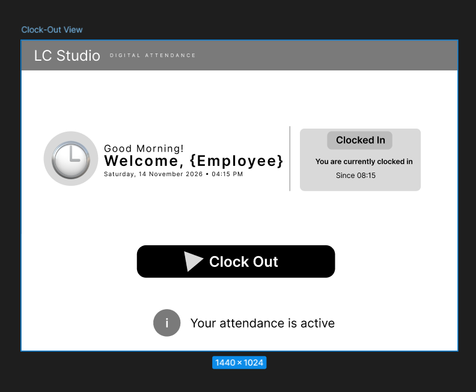
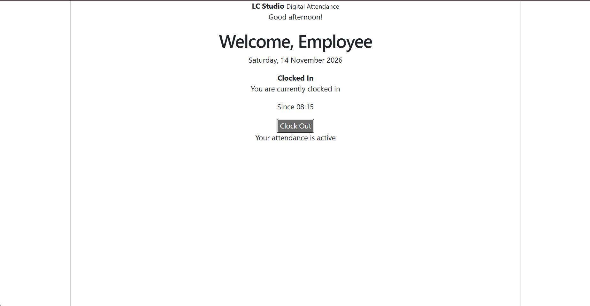

# ST-01 - Clock-Out Screen

## Information
- Ticket ID: S1-10a
- Primary Slack assignee: Phumezile Sibeko (18 November tracker export `Project_tracker(6).json`, supplied by QA).
- Current QA status: Fail - page renders; design conformity fails on the latest visual review.
- Reference: supplied coloured Figma design, [node 99-194](https://www.figma.com/design/Tlkxebvj6tGK2rqH57wFXN/Digital-Attendance-Tracking-System---Wireframe?node-id=99-194). Formal approval of the coloured design is not independently verified; distinguish it from the earlier grayscale wireframe.

## Acceptance Criteria
- [x] Page renders and is reachable (observed on 20 Nov, 3c12382).
- [ ] Page matches the supplied design.

## Test Cases

| Test ID | Scenario | Expected Result | Status |
|---|---|---|---|
| TC-01 | Verify clock-out page rendering and application connection | Page renders and is reachable | Pass (3c12382) |
| TC-02 | Compare page with supplied coloured Figma design | Page structure and styling conform | Fail (3c12382) |

## Objective
- Provide the clock-out page and connect it to the application entry point.

## Acceptance Criteria
- [x] Basic clock-out page structure is implemented; design conformity is assessed separately.
- [x] Page is connected to the application and renders.
- [ ] Page conforms to the approved Figma design.

## Test Cases

| Test ID | Scenario | Expected Result | Status |
|---|---|---|---|
| TC-01 | Verify clock-out page rendering and application connection | Clock-out page renders and is reachable through the application | Pass |
| TC-02 | Compare page with supplied Figma clock-out wireframe | Page structure and visual styling conform to the design | Fail |

## Linked Bugs
- [BUG-S1-10a-01](bugs/BUG-S1-10a-01-screen-design.md) - Clock-out screen does not match the Figma wireframe.

## Testing History

### 17 November 2026 - Preliminary code review
- Tester: Adam Jattiem.
- Test case ID: TC-01, TC-02 (formal tests not run).
- Branch: `frontend4-feature/s1-10a-clock-out`.
- Commit SHA / Figma version: `26f65d5d218a8ce4736151cdc7637b15568d049c`.
- Environment: Windows, local detached Git worktree, React and Vite. Dependency installation succeeded (176 packages; zero reported vulnerabilities).
- Preconditions: Static code review and environment setup only.

#### Steps to Reproduce
1. Formal test steps were not performed; review was limited to static code inspection.

#### Expected Result
- Clock-out page structure is implemented and connected to the application.
- Final page conforms to the approved Ticket 8 design.

#### Actual Result
- Clock-out page structure was implemented correctly and the page is connected to the application.
- Final conformity with the approved design remains unverified.

#### Result
Not Run

#### Bug Reference
None.

#### Evidence
- No browser testing or screenshots recorded.

#### Notes
- Static review does not establish runtime behavior or design conformity. Formal test status remains Not Run.

### 18 November 2026 - Visual runtime test
- Tester: Adam Jattiem.
- Test case ID: TC-01, TC-02.
- Branch: QA4 documentation branch; developer source retrieved from `frontend4-feature/s1-10a-clock-out` into the existing detached testing worktree.
- Commit SHA / Figma version: `d7fb9f83f8f47d4f2e001097fbfa20fccc760ce0`; [Figma clock-out wireframe](https://www.figma.com/design/Tlkxebvj6tGK2rqH57wFXN/Digital-Attendance-Tracking-System---Wireframe?node-id=99-194).
- Environment: Windows, detached Git worktree, React, Vite 8.3.8; `http://localhost:5173/`.
- Preconditions: Vite development server started successfully.

#### Steps to Reproduce
1. Start the Vite development server in the detached testing worktree.
2. Open `http://localhost:5173/` and confirm the clock-out page renders.
3. Compare the rendered page screenshot with the supplied Figma clock-out wireframe.

#### Expected Result
- The page renders and its design matches the supplied wireframe.

#### Actual Result
- The page renders and is connected to the application (TC-01 Pass).
- Design conformity fails (TC-02 Fail). Header styling/alignment differs; the clock icon is missing; greeting and employee information are misplaced; typography, spacing, and alignment differ; current time is missing; date and greeting are hardcoded; vertical divider and attendance information icon are missing; status card position, background, rounded corners, and status indicator styling are incorrect or missing; attendance message position and spacing are incorrect; default Vite styling remains.

#### Result
TC-01 Pass; TC-02 Fail.

#### Bug Reference
- [BUG-S1-10a-01](bugs/BUG-S1-10a-01-screen-design.md) (proposed severity: Medium).

#### Evidence
- **Expected Result — Figma wireframe:** 
- **Actual Result — running application at commit d7fb9f8:** 
- The screenshots support visual comparison only; they do not evidence interactive behavior or attendance state changes.

#### Notes
- Related visual issues are grouped in one bug report. QA4 remained separate and unaffected during commit retrieval/testing.
- The hardcoded date and greeting were identified through source review. Dynamic updates are an inferred requirement requiring confirmation; the screenshots alone do not establish that behavior.

### 19 November 2026 - Prior-build runtime
- Commit `f998ab224f8a83152be733ffbb791079a50869d3`; Vite rendered and the clock-out page was visible. This is prior-build evidence, not a test of 3c12382. No screenshot/log saved.

### 20 November 2026 - Current-build render and visual review
- Tester: Adam Jattiem. Commit `3c1238284b765e7b85f1a55d0fb8f85374cb0aa3` (`added styling to sections`); detached testing worktree, QA4 separate. Vite served `http://127.0.0.1:5173/` successfully.
- Steps: start existing Vite dependencies; open the local page; compare visible elements with coloured Figma node 99-194. Expected: rendered design matches reference. Actual: dark header, teal background, dark card and lime button were present, but the approved Life Choices logo, green employee name, green status badge, correct button text/triangle colours, correct information message/icon and matching clock icon were missing or incorrect. Source review also found the employee-name span uses `clockout-h1` as an attribute instead of `className="clockout-h1"`.
- Result: TC-01 Pass; TC-02 Fail. Functional clock-out logic was unchanged from f998ab2. No fresh screenshot exists; the 18 Nov screenshots are historical and do not show this build.
- Prepared feedback, not sent: Phumezile to fix the className typo and complete remaining styling, logo, badge, clock and message corrections. QA will compare the updated page against the same reference and retest rendering.
- Automated build/lint pass was reported but logs were not located. Chromium automation was blocked by socket creation denial; no application defect is inferred from the harness failure.
