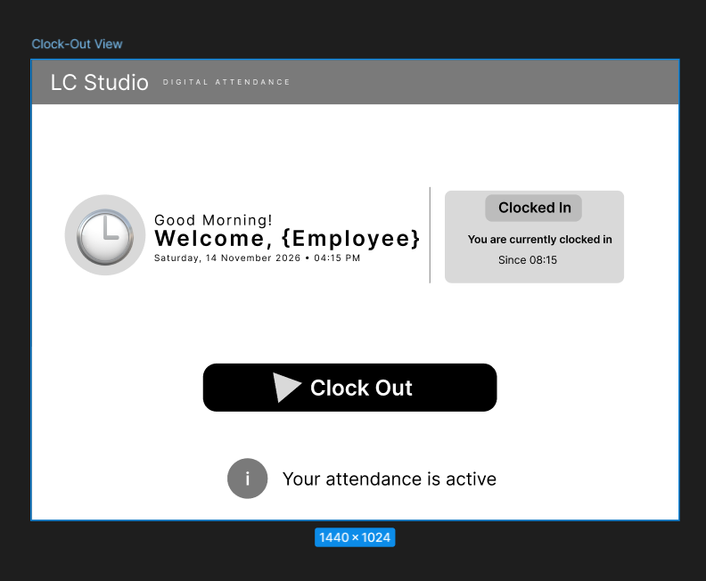
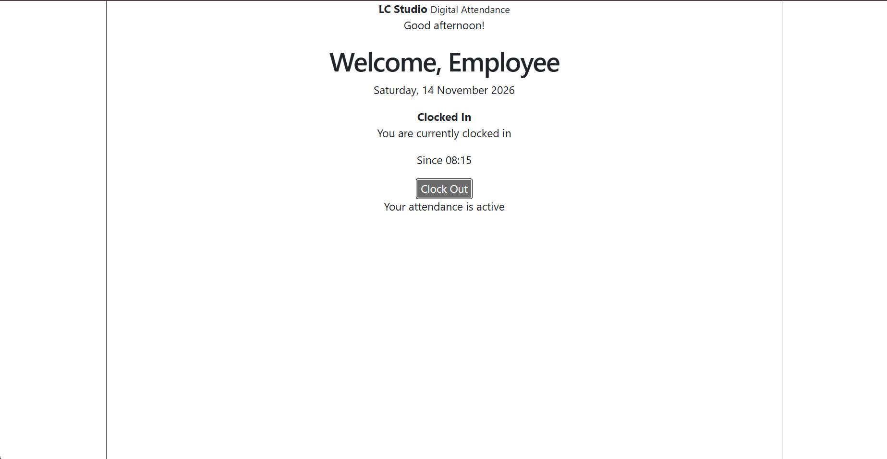

# S1-10a / BUG-S1-10a-01 - Clock-out screen does not match Figma wireframe

## Bug Information
- Ticket ID: S1-10a
- Linked subtask: ST-01
- Linked test case: TC-02
- Date reported: 18 November 2026
- Reported by: Adam Jattiem
- Assigned developer: Phumezile Sibeko
- Severity: Medium (proposed QA classification)
- Status: Open

## Environment
- Branch: `frontend4-feature/s1-10a-clock-out` (tested in detached worktree; QA branch QA4)
- Commit SHA / Figma version: `d7fb9f83f8f47d4f2e001097fbfa20fccc760ce0`; Figma node 99-194
- Browser: Not recorded
- Operating system: Windows
- Device: Not recorded

## Preconditions
- Clock-out page rendered locally at `http://localhost:5173/`.

## Steps to Reproduce
1. Open the running application and compare its clock-out page with the supplied Figma wireframe.

## Expected Result
- Page layout and styling conform to the supplied Figma design.

## Actual Result
- Confirmed visual discrepancies: header styling/alignment, missing clock icon and vertical divider, greeting/employee placement, typography and spacing, absent current time, hardcoded date and greeting, status card placement/styling/indicator, absent attendance information icon, attendance message spacing, and default Vite styling.

## Evidence
- Expected Result — Figma wireframe: 
- Actual Result — running application at commit d7fb9f8: 
- Screenshots establish visual discrepancies only.

## Fix and Retest History
- Date fixed: Pending
- Fix commit: Pending
- Retest date: Pending
- Retest result: Pending
- Notes: Retest the page against the same Figma reference.

## Resolution
Pending QA verification.
