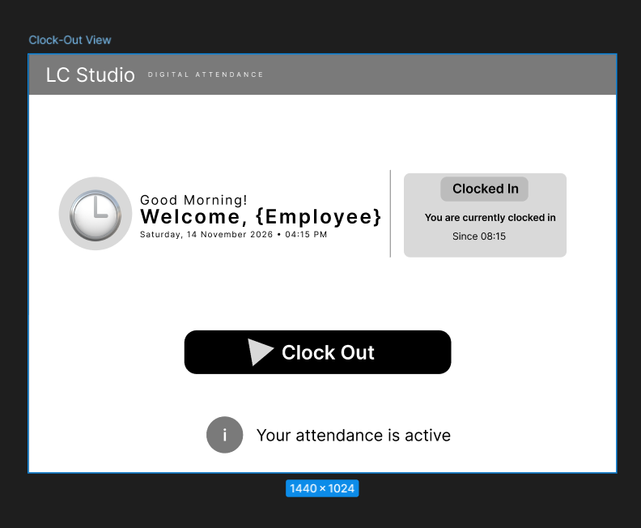
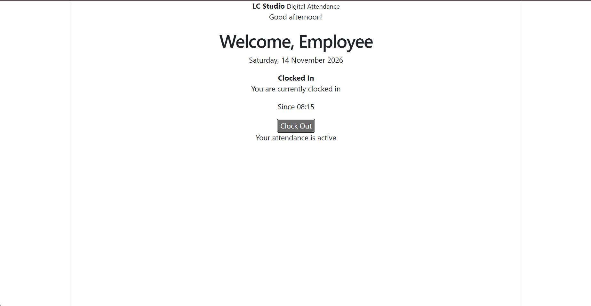

# S1-10a / BUG-S1-10a-04 - Clock-out button design discrepancies

## Bug Information
- Ticket ID: S1-10a
- Linked subtask: ST-03
- Linked test case: TC-03
- Date reported: 18 November 2026
- Reported by: Adam Jattiem
- Assigned developer: Elijah
- Severity: Medium (proposed QA classification)
- Status: Open

## Environment
- Branch: `frontend4-feature/s1-10a-clock-out` (detached testing worktree; QA branch QA4)
- Commit SHA / Figma version: `d7fb9f83f8f47d4f2e001097fbfa20fccc760ce0`; Figma node 99-194
- Browser: Not recorded
- Operating system: Windows
- Device: Not recorded

## Preconditions
- Clock-out page rendered and compared with supplied Figma design.

## Steps to Reproduce
1. Compare the button shown on the rendered page with the supplied Figma clock-out design.
2. Inspect `Clockout.jsx` and `Clockout.css` for component label and styling.

## Expected Result
- Integrated button matches the reference design, including icon and `Clock Out` label.

## Actual Result
- The component label is `Clockout` rather than `Clock Out`, its icon is missing, and component styling does not fully match the reference. Visual mismatch is confirmed; interaction was not tested.

## Evidence
- Expected Result — Figma wireframe: 
- Actual Result — running application at commit d7fb9f8: 
- Images support appearance comparison only, not interactive behavior or status changes.

## Fix and Retest History
- Date fixed: Pending
- Fix commit: Pending
- Retest date: Pending
- Retest result: Pending
- Notes: Compare updated button visually against the same design.

## Resolution
Pending QA verification.
